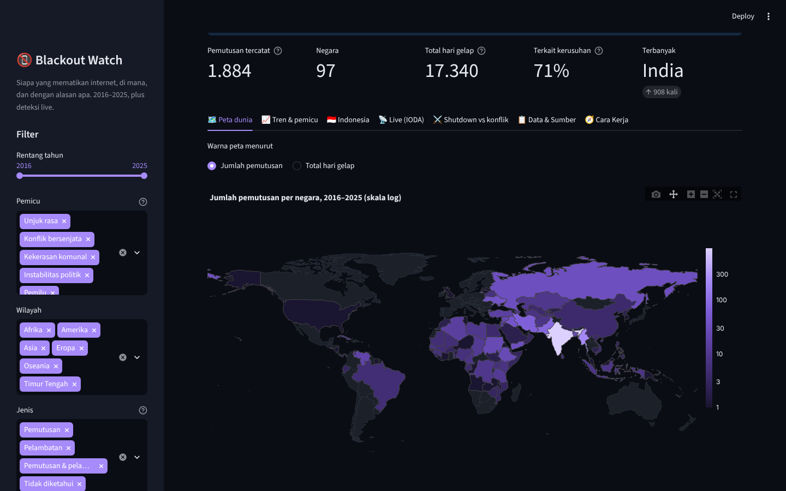
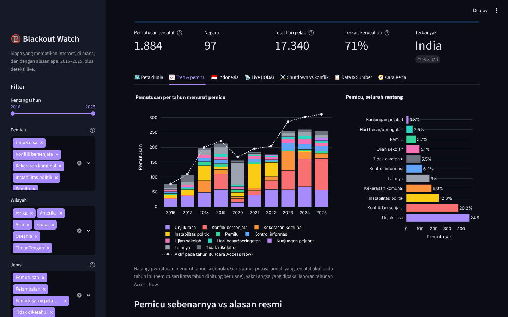
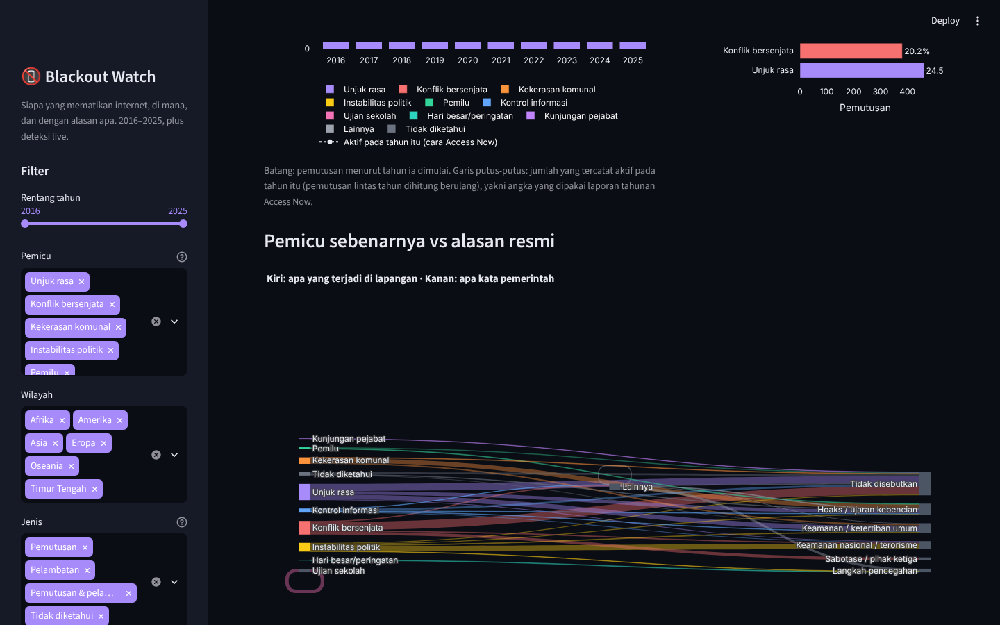
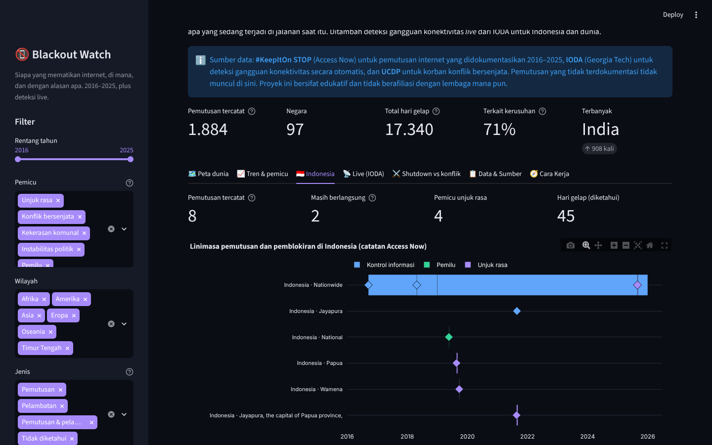
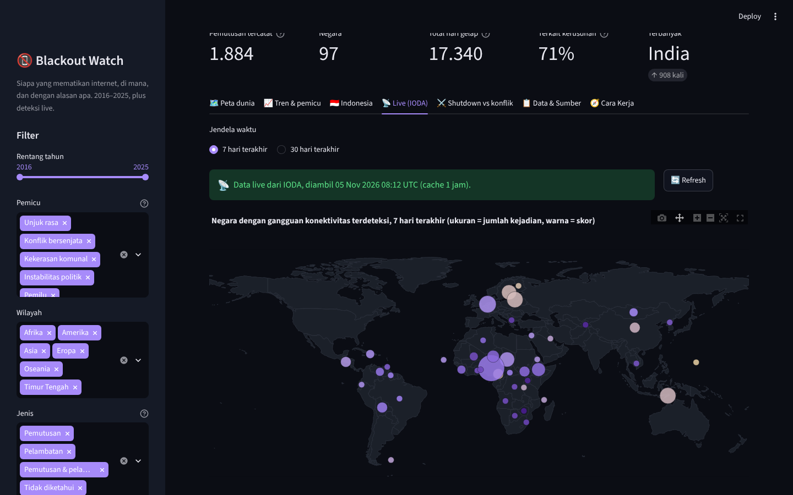
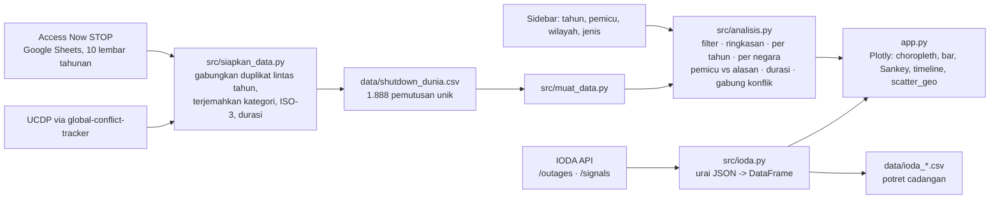

# 📵 Blackout Watch

> **Someone pulled the plug.** Peta dan linimasa **pemutusan internet yang disengaja** di seluruh dunia 2016–2025:
> siapa yang mematikan, di mana, berapa lama, apa yang terjadi di jalanan saat itu, dan apa dalih resminya.
> Ditambah deteksi gangguan konektivitas *live* dari IODA untuk Indonesia dan dunia. Dibangun dengan Python, pandas,
> Plotly, dan Streamlit di atas data terbuka **Access Now #KeepItOn**, **IODA**, dan **UCDP**.

*An interactive tracker of deliberate internet shutdowns worldwide, 2016–2025: a choropleth of 1,888 documented
shutdowns in 97 countries, yearly trends by trigger (protests, conflict, elections, exams), a Sankey of what actually
happened versus what governments said, an Indonesia deep-dive (Papua 2019, the 2019 election blackout, the 2025
TikTok Live block), live outage detection from IODA, and a cross-check against armed-conflict casualties. Python,
pandas, Plotly, Streamlit.*

**🔴 Live demo:** https://blackout-watch.streamlit.app



> ℹ️ **Disclaimer.** Pemutusan diambil dari dokumentasi **Access Now #KeepItOn (STOP dataset)** yang dapat diunduh
> siapa saja. Hanya pemutusan yang terdokumentasi yang muncul; India mendominasi karena pemutusan per distrik dicatat
> satu per satu. Deteksi IODA bersifat otomatis dan hanya menangkap gangguan besar. Proyek ini bersifat edukatif dan
> portofolio pribadi, tidak berafiliasi dengan lembaga mana pun.

## Latar belakang

Agustus 2019: internet seluler di Papua diputus dua minggu saat gelombang unjuk rasa. Mei 2019: WhatsApp dan Instagram
dibatasi setelah kerusuhan pasca-pemilu di Jakarta. Agustus 2025: TikTok Live hilang persis ketika demonstrasi
memanas. Pola yang sama berulang di Myanmar, Iran, India, Etiopia. Pertanyaannya sederhana tetapi jarang dijawab dengan
data: *seberapa sering internet dimatikan karena orang turun ke jalan, dan apa yang dikatakan pemerintah saat
melakukannya?* Access Now telah mendokumentasikan setiap pemutusan sejak 2016 dengan pemicu, alasan resmi, platform
yang diblokir, dan sumbernya. Proyek ini mengubah spreadsheet 45 kolom itu menjadi peta dan grafik, menyandingkannya
dengan pengukuran otomatis IODA, lalu menguji satu dugaan: pemutusan internet mengikuti konflik.

## Fitur

| Tab | Isi |
|---|---|
| 🗺️ Peta dunia | Choropleth jumlah pemutusan atau total "hari gelap" per negara (skala log), 12 negara teratas berwarna pemicu dominan, posisi Indonesia, pembagian wilayah |
| 📈 Tren & pemicu | Batang per tahun menurut pemicu + garis "aktif per tahun" ala laporan Access Now, **Sankey pemicu sebenarnya → alasan resmi pemerintah**, sebaran durasi, platform yang diblokir per tahun, Gantt per negara |
| 🇮🇩 Indonesia | Linimasa 8 pemutusan/pemblokiran, kartu per peristiwa (pemicu, alasan, platform, sumber), **sinyal IODA 7 hari** (BGP, ping, teleskop, Google) dinormalisasi, kejadian terdeteksi 12 bulan terakhir |
| 📡 Live (IODA) | Peta negara dengan gangguan terdeteksi 7/30 hari terakhir, tabel skor, sebaran kejadian menurut durasi; live dengan cache 1 jam, cadangan potret bila API mati |
| ⚔️ Shutdown vs konflik | Setiap negara-tahun: korban konflik bersenjata (UCDP) vs jumlah pemutusan; berapa persen negara berkonflik yang juga memutus internet; siapa yang memutus tanpa perang |
| 📋 Data & Sumber | Tabel sesuai filter dengan tautan sumber, unduh CSV, daftar keterbatasan |
| 🧭 Cara Kerja | Alur data, istilah, fungsi inti |
| 🎓 Mode belajar | Toggle di sidebar: setiap tab menampilkan expander berisi penjelasan dan potongan kode di balik grafiknya |

Filter sidebar (rentang tahun, pemicu, wilayah, jenis, hanya jaringan penuh, cara menghitung tahun) berlaku ke semua
tab kecuali Indonesia dan Live.






## Cara menjalankan

```bash
git clone https://github.com/Avalon2222/blackout-watch.git
cd blackout-watch
python -m venv .venv && source .venv/bin/activate   # Windows: .venv\Scripts\activate
pip install -r requirements.txt
streamlit run app.py
```

Buka `http://localhost:8501`. Jalankan pengujian dengan `python -m pytest tests/ -v` (31 tes, tanpa internet).
Data sudah tersedia di `data/`, jadi aplikasi langsung jalan; tab Live dan sinyal Indonesia memanggil API IODA bila
terjangkau dan memakai potret tersimpan bila tidak.

### Memperbarui data

```bash
python -m src.siapkan_data              # unduh STOP (xlsx 2 MB) + UCDP + potret IODA, bangun ulang semua CSV
python -m src.siapkan_data --hanya-ioda # hanya potret IODA
```

GitHub Actions (`.github/workflows/perbarui-data.yml`) menjalankannya tiap Senin dan melakukan commit bila ada perubahan.

## Cara kerja (ringkas)



Logika berada di `src/analisis.py` (pandas murni, tanpa Streamlit, diuji):

| Fungsi | Yang dihitung |
|---|---|
| `filter_data(df, awal, akhir, pemicu, wilayah, jenis, ...)` | Menyaring sesuai sidebar; `dasar_tahun="aktif"` meniru cara hitung Access Now |
| `ringkasan(df)` | Jumlah, negara, hari gelap, persen terkait kerusuhan, negara teratas |
| `per_tahun(df, pecah)`, `aktif_per_tahun(df)` | Tren per tahun mulai vs per tahun aktif |
| `per_negara(df)`, `top_negara`, `peringkat_negara` | Agregat choropleth dan peringkat |
| `pemicu_vs_alasan(df)` | Pasangan pemicu → alasan resmi untuk Sankey |
| `platform_per_tahun(df)`, `sebaran_durasi(df)`, `kategori_durasi` | Platform diblokir; kelompok durasi |
| `linimasa(df)` | Baris Gantt dengan tanggal selesai yang diisi bila kosong |
| `gabung_konflik(...)`, `korelasi_konflik(...)` | Silang dengan korban konflik UCDP per negara-tahun |

`src/ioda.py` berisi klien API IODA; fungsi `urai_*` mengubah JSON menjadi DataFrame dan diuji tanpa jaringan.
`src/siapkan_data.py` berisi ETL dengan fungsi murni `gabungkan_duplikat`, `rapikan`, `hitung_durasi`.

## Data

| File | Isi | Baris |
|---|---|---|
| `data/shutdown_dunia.csv` | Pemutusan unik 2016–2025 (+ beberapa pemblokiran lama yang masih berlangsung): negara, tanggal, durasi, pemicu, alasan resmi, platform, kekerasan, sumber | 1.888 |
| `data/korban_konflik_negara_tahun.csv` | Korban konflik bersenjata per negara-tahun 2016–2026 (UCDP, agregat dari proyek global-conflict-tracker) | 706 |
| `data/ioda_*.csv` | Potret IODA: ringkasan 30 hari, kejadian dunia 30 hari, kejadian Indonesia 12 bulan, sinyal Indonesia 7 hari | – |

Spreadsheet Access Now memuat 2.102 baris karena pemutusan yang masih berjalan diulang di tiap lembar tahunan;
penggabungan menjadi 1.888 pemutusan unik dan rekonstruksi angka "aktif per tahun" (2025 = 313, sama dengan laporan
resmi) dijelaskan di [`data/SUMBER_DATA.md`](data/SUMBER_DATA.md).

## Beberapa hal yang terlihat dari data

Pengamatan pribadi dari dashboard dengan filter bawaan (2016–2025, semua pemicu):

1. **Tujuh dari sepuluh pemutusan terjadi saat ada kerusuhan.** Unjuk rasa (24%), konflik bersenjata (20%),
   instabilitas politik (13%), kekerasan komunal (10%), dan pemilu (4%) menyumbang 71% pemicu. Ujian sekolah
   menyumbang 5%: Irak, Suriah, dan Aljazair mematikan internet nasional agar siswa tidak menyontek.
2. **Yang terjadi dan yang dikatakan berbeda.** Pita terbesar di Sankey: pemutusan saat konflik dan unjuk rasa paling
   sering **tanpa pernyataan resmi sama sekali**. Ketika ada pernyataan, "hoaks dan ujaran kebencian" adalah dalih
   favorit untuk kekerasan komunal dan unjuk rasa.
3. **2023–2025 adalah rekor berturut-turut** (255, 260, 254 pemutusan dimulai; 288, 304, 313 aktif), didorong Myanmar,
   India (Manipur), dan Pakistan.
4. **India dan Myanmar adalah dua pertiga data dunia**: 908 dan 215 pemutusan. Indonesia berada di urutan ke-26 dengan
   8 catatan, tetapi tiga pemutusan jaringan penuhnya semuanya di Papua dan semuanya saat unjuk rasa.
5. **Pemutusan dan perang berjalan bersama.** 88% pemutusan terjadi di negara-tahun dengan ≥ 25 korban konflik bersenjata
   (ambang UCDP), dan 41% negara-tahun berkonflik juga memutus internet. Tetapi arahnya bukan sebab-akibat: Meksiko dan
   Brasil berdarah tanpa pemutusan, Irak dan Aljazair memutus tanpa perang (karena ujian).
6. **IODA jarang "melihat" Indonesia.** Pemutusan Papua 2019 tidak menggeser sinyal nasional; sinyal negara sebesar
   Indonesia hanya bergerak untuk gangguan besar, misalnya kabel laut putus. Itulah alasan dokumentasi manusia dan
   pengukuran otomatis dipasang berdampingan.

Angka di sini adalah bahan diskusi, bukan kesimpulan: baca dulu daftar keterbatasan di tab Data & Sumber.

## Struktur repositori

```
blackout-watch/
├── app.py                        # tampilan Streamlit (dibaca dari atas ke bawah)
├── src/
│   ├── siapkan_data.py           # ETL: STOP xlsx + UCDP + potret IODA -> data/*.csv
│   ├── negara.py                 # nama Access Now -> ISO-3 + nama Indonesia + wilayah
│   ├── ioda.py                   # klien API IODA + parser murni
│   ├── muat_data.py              # baca & validasi CSV
│   └── analisis.py               # fungsi analisis murni pandas (diuji)
├── data/                         # 6 CSV + SUMBER_DATA.md (raw/ diabaikan git)
├── tests/test_analisis.py        # 31 tes pytest
├── docs/
│   ├── BELAJAR.md                # panduan belajar bertahap
│   ├── LATIHAN.md                # latihan beserta kunci jawaban
│   └── screenshots/
├── .github/workflows/            # tes tiap push + pembaruan data mingguan
└── requirements.txt
```

## Belajar dari proyek ini

Mulailah dari [`docs/BELAJAR.md`](docs/BELAJAR.md) (cara membaca spreadsheet Access Now, mengapa duplikat lintas tahun
harus digabung, choropleth log, Sankey, menyatukan dua dataset lewat ISO-3, memanggil API dengan cadangan), lalu
kerjakan [`docs/LATIHAN.md`](docs/LATIHAN.md). Aktifkan **Mode belajar** di sidebar agar setiap grafik menampilkan kode
di baliknya.

## Rencana pengembangan

- [ ] Lapisan **OONI** untuk pemblokiran situs/aplikasi per negara (bukti pengukuran, bukan hanya laporan).
- [ ] **Cloudflare Radar** sebagai sumber live kedua (memerlukan token; opsional lewat `secrets.toml`).
- [ ] Sinyal IODA tingkat **provinsi** (IODA punya entitas *region*, misalnya Papua) agar pemutusan lokal terlihat.
- [ ] Animasi choropleth per tahun dan normalisasi per jumlah pengguna internet (ITU).
- [ ] Peringatan otomatis: GitHub Actions memeriksa IODA tiap jam dan membuka *issue* jika sinyal Indonesia anjlok.

## Lisensi

Kode: MIT. Data: Access Now #KeepItOn STOP dataset (publik, sebutkan Access Now), IODA (Georgia Tech Research
Corporation, akses publik), UCDP GED/Candidate (CC BY 4.0).
